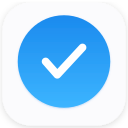
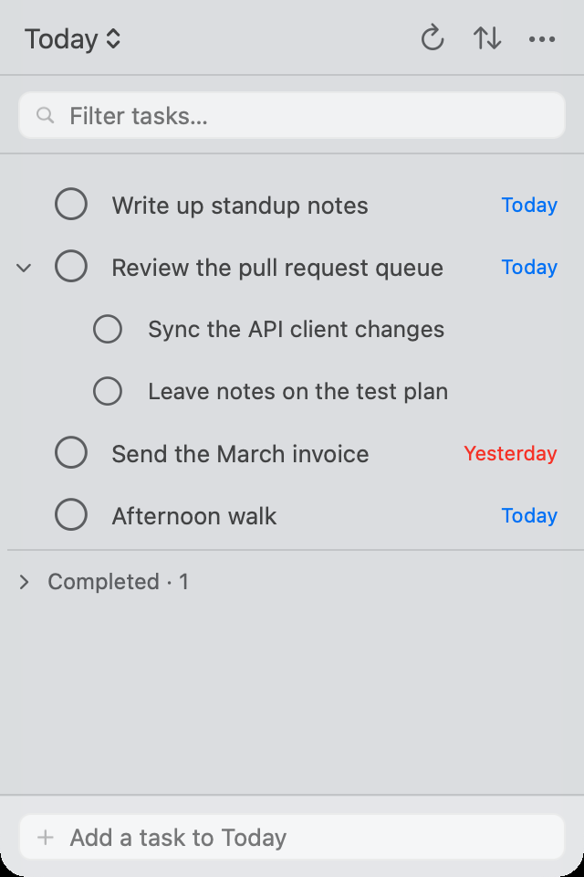
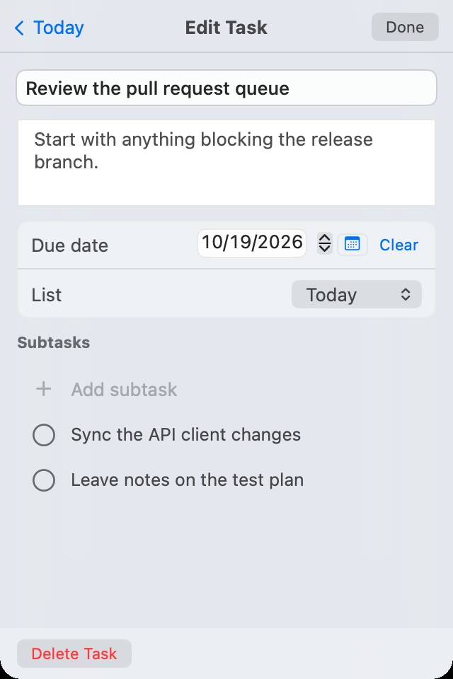

<p align="center">
  
</p>

<h1 align="center">TaskMenu</h1>

<p align="center">
  A free, open-source Google Tasks app for the Mac menu bar.
  <br />
  Native AppKit, quick add, subtasks, due-date reminders, and two lists side by side.
</p>

<p align="center">
  <a href="https://github.com/crazytan/TaskMenu/releases/latest">
    
  </a>
  <a href="#installation">
    
  </a>
  
  
  <a href="LICENSE">
    
  </a>
</p>

## Why TaskMenu?

TaskMenu keeps your Google Tasks a click away while you work. Open a compact popover from the menu bar, add a task, check off a subtask, or compare two lists side by side. It stays out of the Dock and syncs changes directly with your Google account.

<p align="center">
  
  
</p>

## Highlights

| Area | What TaskMenu Does |
| --- | --- |
| **Menu bar access** | Opens in a compact popover with no Dock icon or main window. Optionally shows a count of open tasks or tasks due today, including overdue tasks. |
| **Task editing** | Create, edit, complete, and delete tasks, with notes, due dates, and subtasks. Add tasks and subtasks inline. |
| **Lists and ordering** | Create lists, switch between them, move tasks with their subtasks to another list, and drag to reorder or nest tasks. Sort by Google's order or due date. |
| **Side-by-side lists** | Show two lists at once, each with its own picker, filter, quick add, sort order, and editor. |
| **Reminders** | Optional local macOS notifications for due dates. Reminders use the date exposed by Google's API. |
| **Keyboard access** | Use ⌘N to add a task, ⌘F to filter, and ⌘, to open Settings. Optionally launch at login. |
| **Demo mode** | Choose “Explore the Demo” before signing in to try sample lists. Demo edits stay in memory and are discarded when you leave. |
| **Desktop widget (unreleased)** | Source builds include a configurable widget for viewing and completing tasks, with live refresh and cached content when offline. |

## Installation

Requires **macOS 14.4 (Sonoma) or later**.

Install with Homebrew by trusting the cask first:

```bash
brew trust --cask crazytan/tap/taskmenu
brew install --cask crazytan/tap/taskmenu
```

Or download the signed and notarized DMG from the [latest GitHub release](https://github.com/crazytan/TaskMenu/releases/latest).

After opening TaskMenu, sign in with Google or choose **Explore the Demo** to try it without an account.

## Privacy

TaskMenu connects directly to Google for OAuth 2.0 sign-in with PKCE and task sync. Sign-in tokens are stored in the macOS Keychain. There is no TaskMenu account or TaskMenu-operated server storing your tasks, and no third-party analytics SDK.

Due-date reminders are local macOS notifications. Apple's MetricKit diagnostics are saved locally and are not uploaded. Direct-download builds also contact GitHub for release update checks; App Store builds leave out that update path. Source builds with the desktop widget keep a minimized task snapshot locally in the shared App Group so the widget can display cached content.

Read the [privacy policy](https://taskmenu.crazytan.dev/privacy).

## Build From Source

Requires **Xcode 26.4 or later**, **XcodeGen**, and a Google Cloud project with the Google Tasks API enabled.

1. Clone the repository:

   ```bash
   git clone https://github.com/crazytan/TaskMenu.git
   cd TaskMenu
   ```

2. Create or configure a Google Cloud project:

   - Enable the Google Tasks API
   - Create an iOS OAuth client in Google Cloud Console for bundle ID `dev.crazytan.TaskMenu`

3. Copy the example config and add your Google OAuth credentials:

   ```bash
   cp Config.xcconfig.example Config.xcconfig
   ```

   Fill in `GOOGLE_CLIENT_ID`, `GOOGLE_REDIRECT_SCHEME`, and your signing `DEVELOPMENT_TEAM` in `Config.xcconfig`. Keep this file private; it is excluded from Git. See [the release guide](docs/RELEASING.md#one-time-apple-developer-portal-setup-required-before-any-signed-build) for the App Group and Keychain Sharing capabilities needed by the app and widget.

4. Generate the Xcode project:

   ```bash
   xcodegen generate
   ```

5. Open `TaskMenu.xcodeproj` in Xcode and build the app.

## Development

- Swift 6
- AppKit
- XcodeGen-generated Xcode project
- Apple frameworks only, with zero third-party dependencies
- Strict concurrency enabled
- Builds are stamped with the current git commit by `scripts/stamp_build_metadata.sh` (a scheme build pre-action), and Settings shows it next to the version

Build from the command line with:

```bash
xcodebuild build -project TaskMenu.xcodeproj -scheme TaskMenu \
  -configuration Debug \
  -destination "platform=macOS"
```

Run a focused test slice with:

```bash
xcodebuild test -project TaskMenu.xcodeproj -scheme TaskMenu \
  -configuration Debug \
  -destination "platform=macOS" \
  -only-testing:TaskMenuTests/AppStateTests
```

## FAQ: Google Tasks API Limitations

### Why does TaskMenu not match every feature in the Google Tasks web app?

TaskMenu uses the public Google Tasks API, which is smaller than the Google Tasks and Google Calendar web interfaces. The API can manage task lists and core task fields such as title, notes, completion status, ordering, subtasks, and due dates, but not every first-party UI feature is exposed as a public read/write field.

For reference, Google documents the public task resource in the [Tasks API reference](https://developers.google.com/workspace/tasks/reference/rest/v1/tasks), while the web app can also create tasks with features like date/time, deadlines, repeating schedules, and notifications in [Google Tasks Help](https://support.google.com/tasks/answer/7675838?co=GENIE.Platform%3DDesktop&hl=en).

### Why can I set a date, but not an exact task time?

The API's `due` field is date-only. Google accepts it as an RFC 3339 timestamp, but discards the time portion when the due date is set, and the API cannot read or write the time a task is due. TaskMenu therefore syncs calendar days, not task times.

### Are TaskMenu reminders the same as Google Tasks notifications?

No. Google Tasks and Google Calendar can send their own notifications for tasks, including tasks with a date and time. TaskMenu can only see the date-only value exposed by the API, so its due-date reminders are local macOS notifications scheduled by TaskMenu. They do not create or edit Google Tasks notification settings.

### Can TaskMenu create or edit repeating tasks?

Not currently. Google Tasks and Google Calendar can create repeating tasks, but the public Tasks API task resource does not expose a recurrence rule field that TaskMenu can read and write. Google's API documentation also calls out special restrictions for recurrent tasks in task moves. TaskMenu treats repeating tasks conservatively and does not create or edit repeat schedules.

See Google's [repeating tasks help](https://support.google.com/tasks/answer/12132599?co=GENIE.Platform%3DDesktop&hl=en) and the Tasks API [`move` method](https://developers.google.com/workspace/tasks/reference/rest/v1/tasks/move).

### Why does TaskMenu not show starred tasks or a Starred list?

Stars are available in Google's Tasks UI, but starred status and the Starred smart list are not fields on the public `Task` or `TaskList` resources. Without an official API field, TaskMenu cannot reliably sync, set, or filter starred tasks.

See Google's [starred tasks help](https://support.google.com/tasks/answer/12718779?co=GENIE.Platform%3DDesktop&hl=en).

### What about tasks from Gmail, Docs, Chat, or Keep?

Google's web apps can create tasks from other Workspace products. The Tasks API exposes some of that context as read-only links or assignment metadata, and assigned tasks from Docs or Chat are not returned by default unless an API client explicitly requests them. TaskMenu currently focuses on regular Google Tasks lists and does not request assigned tasks, so some source links, assignment details, and shared-task behaviors may be unavailable or read-only.

See the [`tasks.list` reference](https://developers.google.com/workspace/tasks/reference/rest/v1/tasks/list) and [Tasks API usage limits](https://developers.google.com/workspace/tasks/limits).

## Project Map

```text
TaskMenu/
├── Models/           # App state, Google Tasks models, ordering, and search
├── Services/         # OAuth, Google Tasks API, Keychain, reminders, metrics, updates
├── Views/            # AppKit popover, task editor, settings, and shared controls
├── Utilities/        # Constants and date formatting
├── Resources/        # Plist, entitlements, icons, and asset catalog
├── WidgetSupport/    # Shared widget snapshots, refresh, completion, and deep links
TaskMenuWidget/       # WidgetKit desktop and Notification Center extension
TaskMenuTests/        # Unit tests and test doubles
AppStorePreviews/     # Marketing and App Store preview sources
scripts/             # Build metadata and release tooling
docs/                # Public website, policies, support, and release guide
project.yml          # XcodeGen build graph; edit this instead of the Xcode project
```

## Docs

- [`CHANGELOG.md`](CHANGELOG.md) - version history and unreleased changes
- [`AGENTS.md`](AGENTS.md) - context for coding agents and repository conventions
- [`TaskMenu/README.md`](TaskMenu/README.md) - app architecture, lifecycle, and state flow
- [`TaskMenuWidget/README.md`](TaskMenuWidget/README.md) - widget architecture and shared-source boundaries
- [`TaskMenuTests/README.md`](TaskMenuTests/README.md) - test map and focused test selection
- [`docs/RELEASING.md`](docs/RELEASING.md) - signing, packaging, Homebrew, and App Store distribution

## Support

- Website: [taskmenu.crazytan.dev](https://taskmenu.crazytan.dev/)
- Direct Mac download: [latest GitHub release](https://github.com/crazytan/TaskMenu/releases/latest)
- Help: [TaskMenu Support](https://taskmenu.crazytan.dev/support)
- Bugs and feature requests: [GitHub Issues](https://github.com/crazytan/TaskMenu/issues)

## Contributing

Contributions are welcome. Open an issue for a bug or feature request, or submit a pull request with a focused improvement. Follow the [build instructions](#build-from-source) above, start with [`AGENTS.md`](AGENTS.md), and read the folder-local `README.md` closest to the code you are changing.

## License

TaskMenu is GPLv3 licensed. See [`LICENSE`](LICENSE) for details.

## Star History

[](https://www.star-history.com/#crazytan/TaskMenu&Date)
